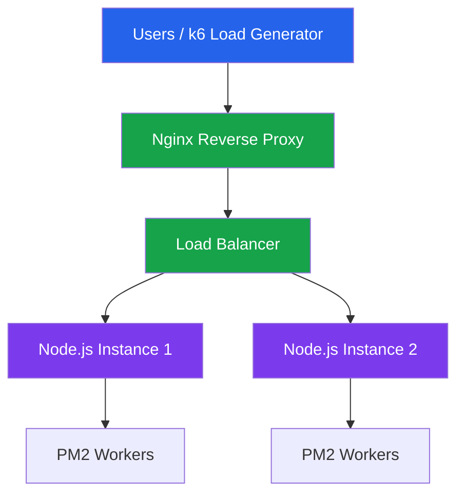

# 🚀 Scaling Lab — Node.js Performance & Scalability

A hands-on engineering lab exploring **Node.js performance, process management, load testing, reverse proxies, and horizontal scaling**.

The goal is to understand how backend applications behave under increasing workloads, identify performance bottlenecks, and progressively build a scalable backend architecture.

> **Learning path:** Node.js → PM2 → k6 → Nginx → Load Balancing → Performance Comparison

---

## 🏗️ Architecture Overview

The project progressively evolves from a single Node.js process into a multi-instance backend architecture behind an Nginx reverse proxy.



**Architecture components:**

| Component | Responsibility |
|---|---|
| Node.js + Fastify | Backend application and HTTP endpoints |
| PM2 | Process management, cluster mode and crash recovery |
| k6 | Load testing, stress testing and performance measurement |
| Nginx | Reverse proxy, load balancing, HTTPS and compression |
| Docker | Running the Linux-based Nginx environment locally |

*The architecture diagram represents the target architecture. The current implementation is being built incrementally.*

---

## 🎯 Project Objectives

- Understand Node.js single-threaded JavaScript execution.
- Explore the difference between PM2 fork mode and cluster mode.
- Measure throughput, latency, and error rates under load.
- Identify application bottlenecks through load and stress testing.
- Understand reverse proxies and how Nginx forwards requests.
- Distribute traffic across multiple backend instances.
- Experiment with Gzip compression, HTTPS and connection reuse.
- Compare performance before and after introducing Nginx.
- Develop practical knowledge of horizontal and vertical scaling.

---

## 🛠️ Technology Stack

| Technology | Purpose |
|---|---|
| Node.js | Backend runtime |
| Fastify | HTTP server framework |
| TypeScript | Type-safe application development |
| PM2 | Process and cluster management |
| k6 | Load and stress testing |
| Nginx | Reverse proxy and load balancer |
| Docker | Nginx container environment |
| PowerShell | Local development environment |

---

## 📁 Project Structure

```text
scaling-lab/
│
├── app/
│   ├── src/
│   │   ├── routes/
│   │   ├── plugins/
│   │   └── server.ts
│   ├── ecosystem.config.js
│   └── package.json
│
├── k6/
│   ├── smoke.js
│   ├── load.js
│   └── stress.js
│
├── nginx/
│   ├── nginx.conf
│   └── certs/
│
├── GUIDE.md
├── PM2-PRACTICE.md
├── RESULTS.md
├── docker-compose.yml
└── README.md
```

## 📚 Learning Roadmap

The lab is organized into progressive implementation steps.

| Step | Topic | Key Concepts | Status |
|---|---|---|---|
| 0 | Environment setup | Tools, dependencies, project skeleton | ✅ Complete |
| 1 | Base application | Fastify, TypeScript, single process | ✅ Complete |
| 2 | PM2 | Fork vs cluster, crash recovery | ✅ Complete |
| 3 | k6 baseline | Smoke testing, load testing, stress testing | ✅ Complete |
| 4 | Nginx | Reverse proxy, load balancing, Gzip, SSL | ⬜ In progress |
| 5 | Performance comparison | k6 through Nginx, benchmark analysis | ⬜ Planned |

### Step 0 — Environment Setup
Prepare the local development environment and establish the project structure.

### Step 1 — Base Application
Build a Fastify + TypeScript server and understand how a single Node.js process handles incoming requests.

### Step 2 — PM2 Process Management
Explore:
- Fork mode vs cluster mode.
- Running multiple Node.js workers.
- Automatic restart and crash recovery.
- Process monitoring.
- CPU-bound workload behavior.

### Step 3 — k6 Performance Testing
Establish performance baselines without Nginx.

Explore:
- Smoke testing.
- Load testing.
- Stress testing.
- Virtual users (VUs).
- Requests per second (RPS).
- Average, P95 and P99 latency.
- HTTP failure rate and thresholds.

### Step 4 — Nginx Reverse Proxy
Introduce Nginx as the application's entry point.

Explore:
- Basic reverse proxy configuration.
- Traffic distribution across multiple backend instances.
- Upstream connection keepalive.
- Forwarded headers and real client IP.
- Gzip compression.
- HTTPS with a local test certificate.
- Backend failure handling.

### Step 5 — Benchmark Comparison
Run the same k6 workloads through Nginx and compare the results against the previous baseline.

Analyze:
- Throughput differences.
- Response time and latency.
- P95 and P99 behavior.
- Error rates.
- Nginx overhead.
- Load balancing behavior.
- Backend failure scenarios.

---

## 📊 Performance Experiments

Performance measurements are recorded in [`RESULTS.md`](RESULTS.md).

### Initial benchmark observations

**Experiment 1 — `/products` endpoint**

| Configuration | RPS | Average Latency | P95 |
|---|---:|---:|---:|
| 1 PM2 fork process | 10,444.7 | 3.77 ms | 6.84 ms |
| 8 PM2 cluster workers | 18,837.3 | 2.01 ms | 4.02 ms |

**Observation:** Cluster mode improved throughput by approximately 80.3% in this local experiment.

**Experiment 2 — CPU-intensive `/heavy?ms=50` endpoint**

| Configuration | RPS | Average Latency | P95 |
|---|---:|---:|---:|
| 1 PM2 worker | 19.98 | 807.75 ms | ~1,000 ms |
| 8 PM2 workers | 146.04 | 109.98 ms | 162.86 ms |

**Observation:** Multiple Node.js processes significantly improved throughput for synchronous CPU-intensive workloads.

> These are local benchmark results, not production capacity guarantees. Results depend on hardware, workload characteristics, operating system scheduling and test conditions.

---

## 🧪 Running the Experiments

Run commands from the project root unless specified otherwise.

### Start the application

```powershell
cd app
pnpm dev
```

### Run PM2 in fork mode

```powershell
cd app
pnpm pm2:fork
```

### Run PM2 in cluster mode

```powershell
cd app
pnpm pm2:cluster
```

### Monitor PM2 processes

```powershell
pm2 monit
```

### Run a k6 smoke test

```powershell
k6 run k6/smoke.js
```

### Run a k6 load test

```powershell
k6 run k6/load.js
```

### Run a CPU-intensive workload

```powershell
k6 run -e "ENDPOINT=/heavy?ms=50" -e VUS=20 k6/load.js
```

### Run a stress test

```powershell
k6 run -e "ENDPOINT=/heavy?ms=50" k6/stress.js
```

*Refer to `GUIDE.md` for the complete setup, configuration and execution instructions.*

---

## 📖 Documentation

| Document | Description |
|---|---|
| [`GUIDE.md`](GUIDE.md) | Full step-by-step implementation guide |
| [`PM2-PRACTICE.md`](PM2-PRACTICE.md) | PM2 practical exercises |
| [`RESULTS.md`](RESULTS.md) | Benchmark data and experiment observations |

## 📌 Benchmarking Principles

To make performance comparisons meaningful:

1. Keep the workload and k6 configuration consistent.
2. Use the same endpoint and request parameters.
3. Compare the same virtual-user stages.
4. Record average, P95 and P99 latency.
5. Track throughput and failed-request rate.
6. Monitor CPU and memory usage.
7. Repeat experiments to account for run-to-run variation.
8. Document environmental differences.

The purpose is not simply to achieve the highest RPS, but to understand **why performance changes and where bottlenecks occur.**

---


Every major concept is explored practically, benchmarked where possible, and documented with observations.

**Build → Test → Measure → Analyze → Improve.**
